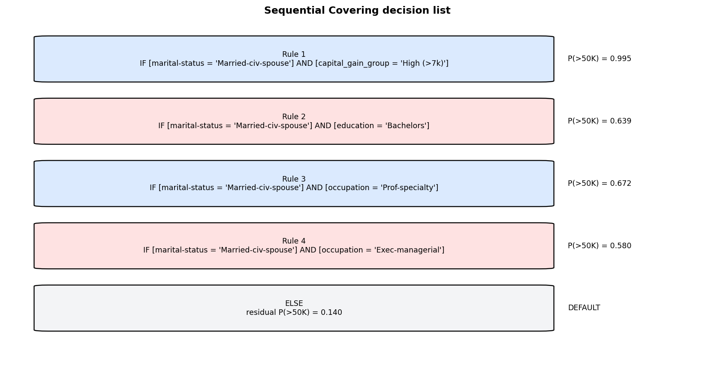
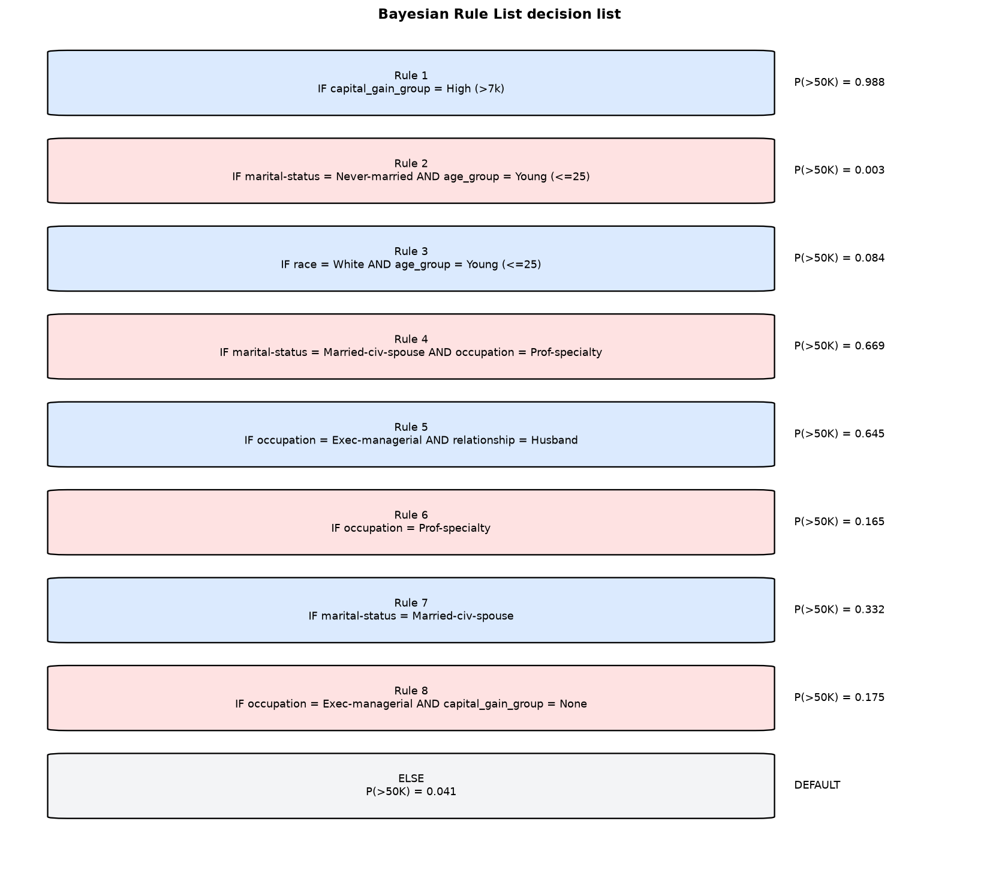
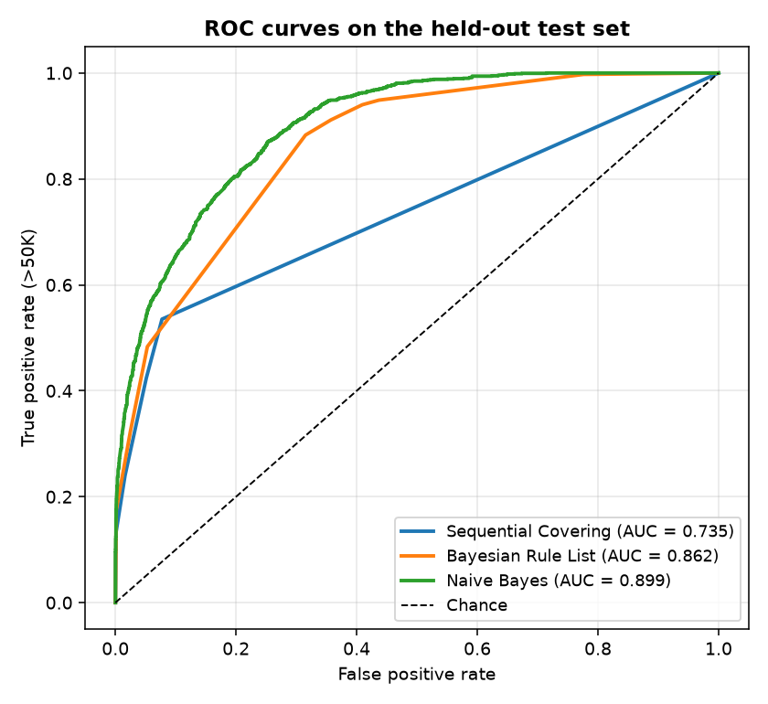
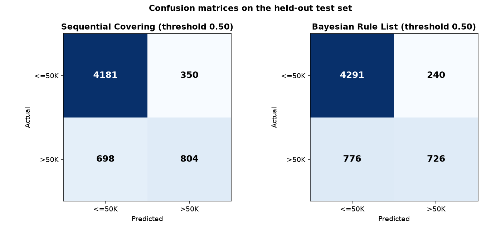
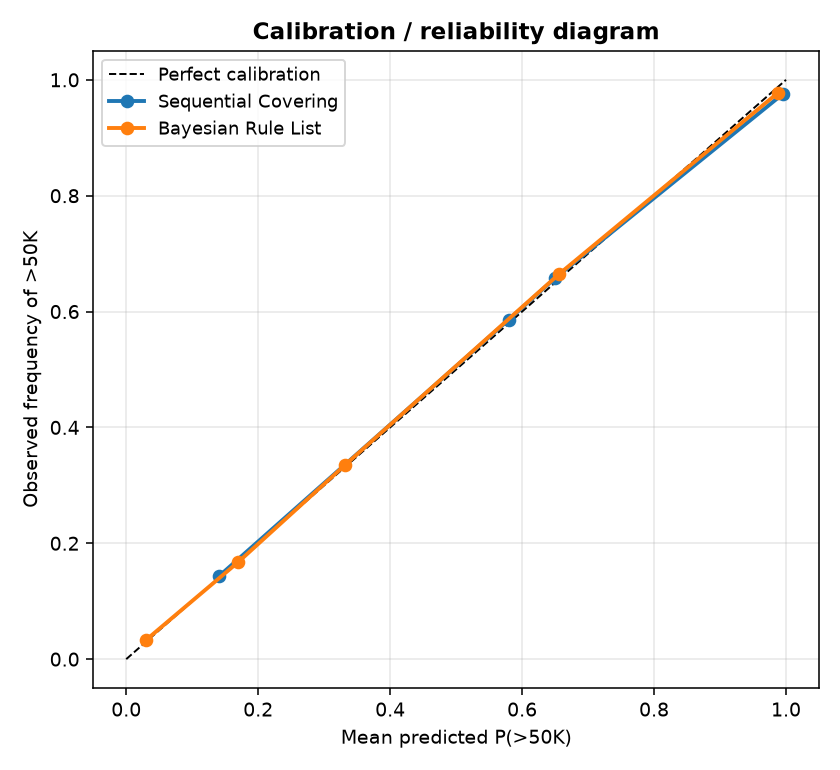

# Interpretable Rule Learning in PyTorch: Group Project Report

**Course:** Interpretable Machine Learning  
**Topic:** Sequential Covering and Bayesian Rule Lists, implemented from scratch in PyTorch  
**Team:** Four members, working in a shared repository

## Project objective

For this assignment we implemented two intrinsically interpretable rule learners in PyTorch, **Sequential Covering** and **Bayesian Rule Lists**, from scratch, and compared them on a single binary classification task: predicting whether a person earns more than $50K. We compare the two approaches on predictive performance, the probability information they provide, and the size of the explanation they produce.

## Libraries used

- **PyTorch** holds the entire rule representation. The dataset is a boolean tensor `M`, and rule coverage, FOIL gain, Cohen's metric, the frequent-pattern pre-mining (`Ms @ Ms.T`) and the Metropolis-Hastings likelihoods are all computed on tensors. Both learning algorithms are written by us against these tensors.
- **pandas** loads and cleans `adult.data`, the discretisation is applied to its columns, and the results tables are built as DataFrames.
- **NumPy** is used for array manipulation in the data and evaluation code.
- **scikit-learn** is used only for splitting (`train_test_split`) and for the evaluation metrics (accuracy, precision, recall, F1, ROC-AUC) and the Naive Bayes comparison baseline. No rule-learning algorithm is taken from it.
- **Matplotlib** generates the report figures (decision lists, ROC, confusion matrices, calibration).

---

## Stage 1: Data and a first baseline (Aritra Bose)

### 1.1 Loading and inspecting the data

We chose the **UCI Adult Census Income** dataset (`adult.data`) from the UCI Machine Learning Repository. It was contributed by Barry Becker and Ronny Kohavi and describes the task as predicting whether annual income exceeds $50K/year from 14 demographic and employment attributes.

We started by loading the file and inspecting it before fitting any model. The loader:

- supplies the 15 column names (the file has no header),
- treats `?` as a missing value,
- strips whitespace from the text columns.

Finding 1: the file contains rows with `?` in `workclass`, `occupation`, and `native-country`. After dropping incomplete rows we went from **32,561 to 30,162 rows** (about 7.4% dropped). We accepted this loss rather than imputing, because inventing a `workclass` value would corrupt the literals the rule learner depends on.

Finding 2: the classes are imbalanced, **75.1% `<=50K`** against **24.9% `>50K`**, so accuracy alone is a misleading metric here. We use precision, recall, F1 and AUC throughout for this reason.

### 1.2 A baseline before any algorithm

Before implementing the rule learners we wanted a floor to compare against, so we added two cheap references:

1. a **majority-class** predictor (always predict `<=50K`), and
2. a **Gaussian/Categorical Naive Bayes** baseline via scikit-learn.

| Quantity | Value |
|---|---|
| Rows before cleaning | 32,561 |
| Rows after dropping missing | 30,162 |
| Class balance | `<=50K` 75.11%, `>50K` 24.89% |

| Baseline | Accuracy | Precision | Recall | F1 | AUC |
|---|---:|---:|---:|---:|---:|
| Majority class | 0.7510 | 0.000 | 0.000 | 0.000 | – |
| Naive Bayes (categorical) | 0.8366 | 0.6459 | 0.7603 | 0.6985 | 0.9128 |

### 1.3 Choosing what to compare against

We used a Naive Bayes baseline, an interpretable model from the course, rather than a gradient-boosted tree, so the comparison stays between interpretable models. The rule learners also need a discrete representation, which we build in Stage 2. Because mapping unseen categories raised a `CategoricalNB` error, we factorised the columns ourselves and mapped unseen categories to a seen code.

### 1.4 Challenges in Stage 1

**Missing values were not marked as missing.** The file writes unknown entries as `?` rather than leaving them blank, so a naive read treats `?` as a real category such as a `workclass` called "?". We passed `?` (and the space-padded `" ?"`) to the reader as explicit missing markers, then dropped the incomplete rows, which removed about 7.4% of the data. We dropped rather than imputed because inventing a `workclass` or `occupation` would create literals that do not correspond to anything real.

**The target label was not clean.** In the test portion the income label is written with a trailing period (`>50K.`), which would silently create two classes where one is intended. We normalise the label by stripping a trailing `.` before encoding it as 0/1.

**An encoding step failed on unseen categories.** Using scikit-learn's categorical encoders directly raised an error when a validation or test row contained a category not seen during fitting. We handled this by factorising the columns ourselves and mapping any unseen value to a known code, so the baseline and the rule models can all be scored on the same held-out rows.

### 1.5 What Stage 1 told us

At 75/25, a majority-class predictor scores 0.7510 accuracy while having zero minority recall, so models are judged on minority-class precision, recall, F1 and AUC as well as accuracy. Naive Bayes scores AUC 0.9128 and F1 0.6985, which is the bar a rule model should approach while staying readable. Rule learners need discrete propositions, and half our columns are continuous, which Stage 2 addresses.

---

## Stage 2: Discretisation and literal encoding (Aritra Bose)

### 2.1 Why we had to discretise at all

A decision rule is a conjunction of *propositions*, e.g. `[education = Bachelors] AND [marital-status = Married-civ-spouse]`. Four of our columns (`age`, `hours-per-week`, `capital-gain`, `capital-loss`) are continuous, so as they stand they cannot appear as readable antecedents. We binned them using boundaries we chose by looking at the distributions, not by fitting a tree:

- age → Young (<=25), Middle-aged (26–45), Senior-Adult (46–65), Senior (>65)
- hours per week → Part-time (<35), Full-time (35–40), Overtime (41–55), Extreme (>55)
- capital gain → None / Moderate (<7k) / High (>7k)
- capital loss → None / Low-Loss (<=1.8k) / High-Loss (>1.8k)

Both capital columns are extremely zero-inflated (the vast majority of people have no gain and no loss), which is why their first bin is "None" for both.

### 2.2 Two columns we dropped

- **`fnlwgt`**, a Census *sampling weight* rather than a personal attribute. When we experimented with keeping it, it produced rules like `[fnlwgt = 123456]`, which cannot be read as a statement about a person. Since the output has to be interpretable, the column was dropped.
- **`education-num`**, a numeric re-encoding of `education`. Keeping both is redundant and the *text* form is easier to read, so we kept `education` and dropped the number.

We also collapsed `native-country` to **United-States vs Other** because the long tail (a handful of people from dozens of countries) would otherwise generate many literals that each cover almost nobody.

### 2.3 Literal encoding with PyTorch tensors

We represent the whole dataset as a single boolean PyTorch tensor `M`. Each row of `M` is one literal `(column = value)`, and `M[i, j] = True` means example `j` satisfies literal `i`. The AND of selected rows gives the coverage of a rule via tensor operations. For every example exactly one literal per column is true, which we checked before learning anything.

| Quantity | Value |
|---|---|
| Features after discretisation | 12 (from 15 raw columns) |
| Total literals (`column = value`) | 73 |
| Coverage tensor `M` | `(73, 30162)`, `dtype=torch.bool` |

### 2.4 Challenges in Stage 2

**Rules need discrete propositions, but four columns were continuous.** `age`, `hours-per-week`, `capital-gain`, and `capital-loss` cannot appear as readable antecedents while they are numbers. We mapped them to named bins with boundaries chosen from the distributions, so a rule can say `[age_group = Young (<=25)]` instead of an unreadable numeric threshold.

**Two columns were almost all one value.** The capital-gain and capital-loss columns are heavily zero-inflated, so deciding where to cut them mattered: a bin edge in the wrong place could put nearly everyone in one group. We gave both a dedicated "None" bin for the zero mass and only split the non-zero part.

**One column produced meaningless literals.** Keeping `fnlwgt` produced rules such as `[fnlwgt = 123456]`, which cannot be read as a statement about a person, so we dropped it (the full reasoning is in 2.2). Collapsing `native-country` to `United-States` vs `Other` solved the related problem of many literals each covering almost nobody.

**The encoding could be silently wrong.** If a value were dropped or duplicated, every rule downstream would be built on a bad tensor without any visible error. We therefore check that for every example exactly one literal per column is true before any learning happens.

---

## Stage 3: Sequential Covering (Chunarkar Sujeeth Kumar)

### 3.1 The algorithm

The algorithm works in a loop. Our implementation follows the RIPPER rule-induction formulation:

```text
SEQUENTIAL-COVERING(X, y):
    alive <- all training examples
    rules <- empty list
    while positive examples remain and rule limit is not reached:
        grow a rule on the current alive examples using FOIL gain
        prune the grown rule using Cohen's metric
        if the pruned rule covers more positives than negatives:
            append the rule to rules
            remove its covered examples from alive
        otherwise:
            stop
    assign the residual positive rate to the default rule
    return rules and default rule
```

The loop is the standard separate-and-conquer idea: grow a rule, prune it, remove the positives it covers, and repeat, with a default rule for the rest. We grow with **FOIL gain** and prune with **Cohen's metric** `(p − n) / (p + n)`.

1. **Grow** one rule that covers positive (`>50K`) examples, using a gain criterion.
2. **Prune** that rule so it does not overfit.
3. **Remove (separate)** the positive examples the rule covers.
4. **Conquer**: repeat on the remaining examples.
5. When no more useful rules can be learned, a **default rule** handles the rest.

### 3.2 Doing the counts with tensors

The expensive part is, at each growth step, counting how many positives and negatives each *candidate literal* would cover. Since the data is already a boolean tensor `M` of shape `(literals, examples)`, this becomes two reductions and a log, with no Python loop over examples. In our code the gain for all literals at once is:

```
p1 = (C & y).sum(1);  n1 = (C & ~y).sum(1)
gain = p1 * (log2(prec_after) - log2(prec_before))
```

where `C = M & covered` is the coverage of the literals that are still consistent with the current rule. The top-scoring literal is appended and the loop continues.

### 3.3 Challenges in Stage 3

**The first rules were only about one feature.** Our first grown rules were all of the form `[marital-status = Married-civ-spouse] AND ...`. Because `marital-status = Married-civ-spouse` has the highest FOIL gain on this dataset, greedy growth kept locking onto it. With a single condition the best rule covered a large share of positives and the later rules became near-duplicates. We handled this by removing covered positives after every rule, so later rules must explain new positives, and by allowing up to 2 conditions so a second, more specific literal can refine the rule.

**Rules grew too specific and covered nobody.** Without pruning, growth can append conditions until the rule matches only a few people. We prune trailing conditions on a held-out third of the alive data using Cohen's metric, and reject any rule that does not cover more positives than negatives.

**Deciding when to stop.** Rather than fixing a rule count, we stop when a grown-then-pruned rule is empty or rejected, or when the alive set runs out of positives or negatives.

### 3.4 Result

Stage 3 produced four rules with a default, all sharing the `marital-status = Married-civ-spouse` condition and refined by a second literal:

| # | Rule | Precision | Covers (pos / neg) |
|---|---|---:|---|
| 1 | `marital-status = Married-civ-spouse` AND `capital_gain_group = High (>7k)` → `>50K` | 0.995 | 826 / 4 |
| 2 | `marital-status = Married-civ-spouse` AND `education = Bachelors` → `>50K` | 0.639 | 1179 / 666 |
| 3 | `marital-status = Married-civ-spouse` AND `occupation = Prof-specialty` → `>50K` | 0.672 | 636 / 310 |
| 4 | `marital-status = Married-civ-spouse` AND `occupation = Exec-managerial` → `>50K` | 0.580 | 640 / 464 |
| – | DEFAULT: else `<=50K` (residual positive rate 0.140) | – | – |

Test metrics: accuracy 0.8263, precision 0.6967, recall 0.5353, F1 0.6054, AUC 0.7354.

The list is short and readable: four rules and a default, read top to bottom. Rule 1 has precision 0.995 on the training set (826 positives vs 4 negatives). The **AUC of 0.7354 is well below the Naive Bayes 0.9128** because the rules output only five distinct precision values (0.995, 0.639, 0.672, 0.580, and the 0.140 default), so the ranking they induce is coarse.

---

## Stage 4: Bayesian Rule List (Mohammad Asad ur Rahman Nisar)

### 4.1 The math we implemented

A Bayesian Rule List is an **ordered** list. Every record is routed to the first rule whose antecedent it satisfies; records that satisfy no rule fall to a **default leaf**. Each leaf `j` has a count of negatives `n0` and positives `n1`:

- **Likelihood (Dirichlet-Multinomial).** Each leaf's log marginal likelihood is `log B(n0 + a0, n1 + a1) − log B(a0, a1)`, computed with `lgamma`. This is the Dirichlet-Multinomial evidence for that leaf.
- **Prior (Truncated-Poisson).** The list length `m` is given a truncated-Poisson prior `lam^m / m!`, which prefers short lists, times a small penalty for each rule wider than one literal (we used a **width penalty** on 2-literal rules).
- **Posterior.** `log posterior = log likelihood + log prior`. We take the argmax as our list.

So the objective is `posterior(list) ∝ likelihood × prior`, with the two specific priors above.

### 4.2 Searching the posterior with Metropolis-Hastings

We cannot enumerate lists, so we sample over them with **Metropolis-Hastings**. Starting from the best single rule, each step proposes one of four moves:

- **add** a candidate rule at a random position,
- **remove** a rule,
- **swap** two rules' positions,
- **replace** one rule with a different candidate.

All proposals are symmetric, so the acceptance ratio reduces to `min(1, exp(posterior(new) − posterior(current)))`. We keep the highest-posterior list seen during the chain.

### 4.3 Bayesian Rule List pseudocode

```text
BAYESIAN-RULE-LIST(X, y):
    candidates <- frequent one-literal and compatible two-literal antecedents
    current <- best single-rule list
    best <- current
    repeat for the MH sampling budget:
        proposal <- add, remove, swap, or replace a rule in current
        compute log posterior(proposal)
        accept proposal with probability
            min(1, exp(log_posterior(proposal) - log_posterior(current)))
        if accepted, current <- proposal
        if current has the highest score so far, best <- current
    for every leaf in best:
        compute posterior-mean P(>50K) from its Dirichlet counts
    return best ordered list and default leaf
```

The search is stochastic, but fixed random seeds make our reported runs reproducible.

### 4.4 Challenges in Stage 4

**The antecedent (candidate rule) space is large.** There are 73 literals, so pairs would be about 2,600 antecedents and triples far more. We **pre-mine** frequent antecedents only: singletons and pairs whose support clears a 3% threshold, computed as a PyTorch matrix product `Ms @ Ms.T` on the boolean masks. This keeps the space small while staying within the frequent-pattern idea behind BRL.

**Coverage must be defined for the data you are predicting on.** Our first `predict_proba` reused the training coverage masks, which only have entries for the training rows and fail on a held-out set of a different size. We fixed it so each rule's coverage is rebuilt from its literals against whatever input tensor is passed in.

**Ordering matters but is invisible in the counts.** Because the first matching rule wins, the same set of rules scores differently under different orders. That is why the swap move exists: it lets the chain reorder rules, for example moving the very specific `capital_gain_group = High` rule to the front, without adding or removing anything.

### 4.5 Result

Stage 4 produced an ordered list of eight rules plus a default leaf, each carrying a posterior-mean probability:

| # | Rule | P(`>50K`) | n0 / n1 |
|---|---|---:|---|
| 1 | `capital_gain_group = High (>7k)` AND `capital_loss_group = None` | 0.988 | 12 / 1050 |
| 2 | `marital-status = Married-civ-spouse` AND `occupation = Prof-specialty` | 0.660 | 491 / 953 |
| 3 | `occupation = Exec-managerial` AND `relationship = Husband` | 0.638 | 538 / 948 |
| 4 | `age_group = Young (<=25)` AND `capital_loss_group = None` | 0.012 | 4241 / 51 |
| 5 | `marital-status = Married-civ-spouse` | 0.333 | 4722 / 2359 |
| 6 | `occupation = Prof-specialty` AND `relationship = Not-in-family` | 0.192 | 680 / 161 |
| 7 | `hours_group = Part-time (<35)` | 0.012 | 1141 / 13 |
| 8 | `hours_group = Full-time (35-40)` | 0.037 | 4595 / 176 |
| – | DEFAULT: else | 0.148 | 1703 / 295 |

Test metrics: accuracy 0.8318, precision 0.7503, recall 0.4860, F1 0.5899, AUC 0.8633.

Unlike Sequential Covering, every leaf carries a **probability** rather than a hard label, and those probabilities are the posterior means from the Dirichlet model. The AUC of **0.8633** is much closer to the Naive Bayes reference (0.9128) than Sequential Covering's 0.7354, as the ordered leaves assign a finer range of posterior probabilities across the dataset (eight distinct values here) than Sequential Covering's few rule confidences plus a default. Precision is also higher (0.7503 vs 0.6967), at the cost of lower recall, and the learned list is longer (8 rules vs 4 rules).

---

## Stage 5: Evaluation and audit (Kotikala Yashwant)

### 5.1 The protocol

In Stages 3 and 4 we compared models on a single 80/20 split with the classification threshold fixed at 0.5. To tune that threshold for each model without it touching the test set, we switched to a **60/20/20** split:

- 60% **train-subset**, the only data the models fit on,
- 20% **validation**, used solely to tune the classification threshold,
- 20% **test**, scored once, never used to choose anything.

We also repeat the whole thing over **three seeds** and report mean ± std, because a single run can hide how stable a method is. We record **explanation size** (rules and literals) so accuracy can be read against complexity.

### 5.2 Threshold tuning

Comparing "best F1" across seeds would tempt us to pick the threshold that looked best on test, so the threshold is selected on validation instead. The tuned threshold is sometimes worse than 0.5 on test, which is what happens when the choice is made without looking at the test set.

### 5.3 Result

Per-run test results over seeds 42/43/44 (`tau` is the validation-selected threshold):

| Model | seed | rules | literals | tau | acc | F1 (0.5) | AUC | F1 (tuned) |
|---|---:|---:|---:|---:|---:|---:|---:|---:|
| SeqCovering | 42 | 4 | 8 | 0.575 | 0.8263 | 0.6054 | 0.7336 | 0.5373 |
| BRL | 42 | 8 | 14 | 0.311 | 0.8283 | 0.5744 | 0.8618 | 0.6235 |
| SeqCovering | 43 | 3 | 6 | 0.634 | 0.8256 | 0.5765 | 0.7144 | 0.5765 |
| BRL | 43 | 8 | 13 | 0.422 | 0.8266 | 0.5572 | 0.8575 | 0.6337 |
| SeqCovering | 44 | 4 | 8 | 0.141 | 0.8218 | 0.6041 | 0.7359 | 0.6041 |
| BRL | 44 | 8 | 15 | 0.286 | 0.8279 | 0.6358 | 0.8541 | 0.6358 |

Mean ± std over the three seeds:

| Model | accuracy | precision | recall | F1 (0.5) | F1 (tuned) | AUC |
|---|---:|---:|---:|---:|---:|---:|
| SeqCovering (3.7 rules, 7.3 literals) | 0.8246 ± 0.0024 | 0.7006 ± 0.0268 | 0.5193 ± 0.0373 | 0.5953 ± 0.0163 | 0.5726 ± 0.0335 | 0.7279 ± 0.0118 |
| BRL (8.0 rules, 14.0 literals) | 0.8276 ± 0.0009 | 0.7291 ± 0.0499 | 0.5022 ± 0.0885 | 0.5891 ± 0.0413 | 0.6310 ± 0.0066 | 0.8578 ± 0.0038 |

### 5.4 Results discussion

- **Both models clear the accuracy baseline (0.7511)** while staying readable. Their accuracies are slightly lower than the single-split Stage 3/4 numbers, likely because the 60% training subset is smaller than the 80% split used earlier, but the ranking picture is the same.
- **Performance and ranking.** BRL has a slightly higher mean accuracy (0.8276 vs 0.8246), but the bigger difference is in ranking: BRL's mean AUC is 0.8578 against Sequential Covering's 0.7279. AUC judges ordering across thresholds, and BRL's several posterior leaf probabilities give it a finer ordering than Sequential Covering's few rule-confidence values plus a default.
- **Precision-recall trade-off.** At threshold 0.5 both models are close: Sequential Covering has a slightly higher F1 (0.5953 vs 0.5891) and recall (0.5193 vs 0.5022), while BRL has higher precision (0.7291 vs 0.7006). When the threshold is tuned on validation data, BRL's F1 rises to 0.6310 while Sequential Covering's falls to 0.5726. Tuning helps BRL but not Sequential Covering, probably because BRL's probability scale transfers better from validation to test than Sequential Covering's coarse, few-valued scores.
- **Explanation size.** Sequential Covering averages 3.7 rules and 7.3 literals; BRL averages 8.0 rules and 14.0 literals, the trade-off shown in the Pareto plot in the results directory. BRL is richer probabilistically, while Sequential Covering is quicker to read. Neither wins on every measure.
- **Stability.** BRL learns 8 rules on every seed with a small accuracy std (±0.0009) and a larger fixed-threshold recall std (±0.0885). Sequential Covering learns 4, 3, and 4 rules across seeds 42, 43, and 44, and its validation-selected threshold `tau` varies from 0.141 to 0.634 as the train/validation split and internal grow/prune split change. The per-seed numbers are saved in the results directory.

`random_state` is fixed for the splits, the PyTorch shuffling generator, and the MH chain, so a given seed reproduces its row.

### 5.5 Challenges in Stage 5

**Choosing the threshold without leaking the test set.** Our first evaluation compared the two models at a single split and picked the best F1, which meant the threshold was being selected using the test labels. We removed the problem by splitting 60/20/20 and tuning the threshold only on validation (`best_tau`), then scoring the test set once with whatever threshold validation chose.

**Keeping the models and the encoding on the same rows.** The rule models are defined over literals, and the literal encoder is fit on the training subset only. Applying it to the validation and test frames had to reuse the same encoder and the same column order, otherwise the boolean coverage tensors would not line up with the rows being predicted. This is the evaluation-side version of the coverage issue described in Stage 4.

**Separating a real difference from run-to-run noise.** A single seed can make either model look better by chance. We repeated the whole split over three seeds and reported mean ± std, which showed that BRL's accuracy is very stable (±0.0009) while its recall is not (±0.0885), and that Sequential Covering's rule count actually varies (4, 3, 4) across seeds.

**Explaining a counter-intuitive result.** Tuning the threshold helped BRL but made Sequential Covering worse. Rather than hide this, we traced it to the probability scales: Sequential Covering emits only a few distinct confidence values, so a threshold chosen on validation can land between two of those values and behave differently on test, while BRL's finer posterior probabilities transfer more reliably.

---

## Visual interpretation of the learned models

The figures below come from the same fixed 80/20 split used for the single-run rule demonstrations, and are drawn from the learned models.

### Learned decision lists

The Sequential Covering diagram shows a short separate-and-conquer ruleset. Each rule is evaluated in order, and the default handles records not covered earlier.



The Bayesian Rule List diagram shows the ordered first-match semantics and the posterior-mean probability assigned to each leaf.



### ROC comparison

The ROC plot compares both rule models with the interpretable Naive Bayes baseline. In this figure, Naive Bayes is trained on the same discretised features as the rule models; the Stage 1 baseline instead uses the raw columns. The single-split AUC difference in the plot is: BRL 0.8633, Sequential Covering 0.7354, and Naive Bayes 0.9128.



### Confusion matrices

These matrices show the threshold-0.5 test decisions for the two assigned models. They complement the precision and recall values by showing the actual TN, FP, FN, and TP counts.



### Calibration

The reliability diagram compares each model's predicted probability with the observed frequency of `>50K`. This is especially important for BRL because its posterior leaf probabilities are part of the model's interpretation.



## Conclusion

We implemented both assigned topics, **Sequential Covering** (separate-and-conquer, RIPPER-inspired rather than a faithful reproduction of all RIPPER heuristics) and **Bayesian Rule Lists** (Dirichlet-Multinomial likelihood, truncated-Poisson length prior, Metropolis-Hastings search with non-symmetric proposals), from scratch in PyTorch on the UCI Adult dataset. The core rule-learning logic is written by us, and the supporting libraries are listed at the start of this report.

**Mean over 3 seeds, 60/20/20 split:**

| Model | rules | literals | Accuracy | Precision | Recall | F1 (0.5) | F1 (tuned) | AUC |
|---|---:|---:|---:|---:|---:|---:|---:|---:|
| Sequential Covering | 3.7 | 7.3 | 0.8246 | 0.7006 | 0.5193 | 0.5953 | 0.5726 | 0.7279 |
| Bayesian Rule List | 8.0 | 14.0 | 0.8276 | 0.7291 | 0.5022 | 0.5891 | 0.6310 | 0.8578 |

Both beat the majority-class baseline (0.7511 accuracy) while staying readable. Sequential Covering gives the smallest explanation; BRL gives better ranking and probability information at the cost of roughly twice the rules and literals.

## Limitations

BRL uses 4,000 MH iterations per fit, so the selected list is the best found rather than a proven global posterior mode, and candidate rules contain at most two literals. The conclusions are specific to the Adult dataset. `race` and `sex` are used as features, and the learned associations are not causal claims.

## Group member roles and contributions

| # | Member | Role | Contribution |
|---|--------|------|--------------|
| 1 | **Aritra Bose** (25EC65R08) | Data, preprocessing | Chose the UCI Adult dataset and handled loading and cleaning, including the `?` missing values and the target normalisation. Wrote the discretisation of the continuous columns and the PyTorch boolean literal encoder, and added the majority-class and Naive Bayes baselines. |
| 2 | **Chunarkar Sujeeth Kumar** (24AI10021) | Sequential Covering | Implemented the separate-and-conquer rule learner: FOIL-gain growth, Cohen-metric pruning, removal of covered examples, and the default rule. Documented the greedy-growth and overfitting problems and how they were fixed. |
| 3 | **Mohammad Asad ur Rahman Nisar** (24AI10038) | Bayesian Rule List | Implemented the Dirichlet-Multinomial likelihood, the truncated-Poisson length prior with a width penalty, the frequent-antecedent pre-mining, and the Metropolis-Hastings search over add, remove, swap and replace moves. Fixed the prediction-time coverage error. |
| 4 | **Kotikala Yashwant** (24AI10034) | Evaluation and integration | Set up the 60/20/20 protocol with validation-only threshold tuning, the three-seed runs, and the accuracy-versus-complexity comparison. Wrote the outcome discussion and the visualization script, and integrated the modules into one runnable pipeline. |
